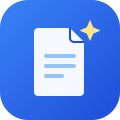

<p align="center">
  
</p>

<h1 align="center">AI Business Writer</h1>

<p align="center">
  Generate resumes, cover letters, proposals, and other business documents in clear, natural,
  human-sounding English — powered by your own self-hosted AI model. No subscriptions,
  no third-party data sharing, no API bills.
</p>

<p align="center">
  
  
  
  
</p>

---

## Overview

AI Business Writer is a small, self-hosted toolkit for everyday professional writing. Pick a
document type, describe the situation, and get a draft written in plain, confident English —
free of AI clichés like *"delve," "leverage,"* and *"in today's fast-paced world."*

It runs entirely on infrastructure you control: a local language model served through
[Ollama](https://ollama.com), orchestrated by an [n8n](https://n8n.io) workflow, with a
lightweight browser-based front end.

## Features

- **16 built-in document types** — resumes, cover letters, emails, memos, proposals, and more
- **Copy to clipboard** or **download as `.txt`** in one click
- **Fully self-hosted** — your data never leaves your own server
- **No sign-up, no API keys to a third party, no subscription**
- **Easy to extend** — add a new document type by editing one file
- **Key-protected webhook** — the tool can't be used by strangers who stumble on the URL

## How it works

```
Browser (index.html)
      │  POST + secret key
      ▼
n8n Webhook ──▶ Check Secret ──▶ Build Prompt ──▶ Ask Model (Ollama) ──▶ Send Result
      │
      └──▶ wrong key? ──▶ 401 Unauthorized
```

## Supported document types

| | | |
|---|---|---|
| Resume Bullet Points | Resume Summary | Cover Letter |
| Professional Email | Follow-Up Email | Meeting Agenda |
| Meeting Minutes | Memo | Business Proposal |
| RFQ Response | Freelance Proposal | LinkedIn About Section |
| Performance Review Feedback | Thank You Note | Invoice Payment Reminder |
| Project Status Update | | |

## Getting Started

### Prerequisites

- A server running [Ollama](https://ollama.com) with a model pulled (e.g. `qwen2.5:3b`)
- A self-hosted or cloud [n8n](https://n8n.io) instance
- A modern web browser

### 1. Import the workflow

In n8n, import [`workflow.json`](./workflow.json). Then, inside the workflow:

- **Check Secret** node — replace `CHANGE_THIS_TO_YOUR_OWN_SECRET_KEY` with a long, random
  string only you know. This is what stops strangers from using your webhook.
- **Ask Model** node — replace `YOUR_OLLAMA_ADDRESS` with your real Ollama server address.
- **Build Prompt** node — set the `model` value to the model name you're actually running
  (check with `ollama list`).
- Turn the workflow **Active**, then copy the **Production URL** from the Webhook node.

### 2. Configure the web tool

Open [`index.html`](./index.html) and edit the two values near the top of the `<script>` tag:

```js
const WEBHOOK_URL = "https://your-n8n-domain/webhook/business-writer";
const API_KEY = "the-same-secret-you-set-in-n8n";
```

### 3. Open it

Double-click `index.html` to open it locally, or deploy it as a static site (see below).

## Keeping your credentials private

This repository is meant to be a clean, shareable template. **Do not commit your real
`WEBHOOK_URL` or `API_KEY`** to a public copy of this repo — anyone browsing GitHub would be
able to read them directly from the file.

A simple way to manage this:

- Keep this **public repo** as-is, with placeholder values — useful for sharing your work or
  letting others set up their own copy.
- Deploy your **own working copy** either by editing `index.html` directly on your server after
  deployment, or by pushing your filled-in version to a **private** repository instead.

Either way, the secret-key check in the n8n workflow is your real protection — it's what
actually stops unauthorized use, regardless of where the URL ends up.

## Deploying the web tool

Any static hosting works. A couple of easy options:

- **Coolify** (if you're already self-hosting n8n there): New Resource → your repo → Static
  build pack → deploy.
- **Netlify Drop**: drag `index.html` onto [app.netlify.com/drop](https://app.netlify.com/drop)
  for a quick public link.

## Customizing the writing style

Open `workflow.json` in n8n and look at the **Build Prompt** node. Each document type has an
`instructions` string and an `example` string — edit these to steer the model's tone, or add a
brand-new document type by adding another entry to the same object.

## Project structure

```
.
├── assets/
│   └── logo.svg
├── index.html       # Front-end tool (Copy / Download buttons)
├── workflow.json     # n8n workflow — import this
├── LICENSE
└── README.md
```

## Roadmap

- [ ] Optional email delivery of generated drafts
- [ ] More document types (contracts, press releases)
- [ ] Fine-tuned custom model support

## Built with

- [Ollama](https://ollama.com) — local model serving
- [Qwen 2.5](https://github.com/QwenLM/Qwen2.5) — the language model
- [n8n](https://n8n.io) — workflow automation
- [Coolify](https://coolify.io) — self-hosted deployment

## License

Released under the [MIT License](./LICENSE).

## Author

**Amanullah Khan**

Developer & Maintainer — Web Development, Front-End Engineering & Social Media Management
📍 Pakistan

<p>
  <a href="https://github.com/amanullahykhan"></a>
  <a href="https://huggingface.co/ak32khan"></a>
  <a href="https://www.linkedin.com/in/amanullahykhan/"></a>
  <a href="https://amanullahykhan.gumroad.com/l/niekk"></a>
</p>
